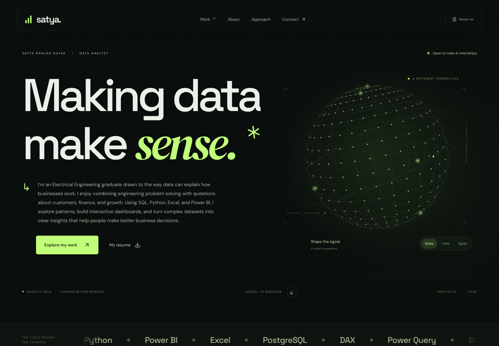

# Satya Ranjan Nayak — Data, made clear.

A cinematic React portfolio with interactive 3D particle artwork, animated typography, scroll-linked depth, magnetic buttons, a source-backed project showcase, and four independent analytics dashboards. Built for Vercel with React 19, Vite, Motion, and Recharts.



[Phone preview](docs/screenshots/homepage-mobile.png)

## Deploy on Vercel

1. Import **satya20000/PortfioDA** in Vercel.
2. Use **Vite** as the framework preset and leave the root directory at the repository root.
3. Build command: `npm run build`. Output directory: `dist`. Install command: `npm ci`.
4. Deploy. There are **no API keys or environment variables** to configure.

`vercel.json` preserves direct links to dashboards and routes while serving data, resume, and assets as static files. The project requires Node 22.12+; Node 24 is supported.

## Run locally

```bash
npm ci
npm run dev
```

Open the local URL printed by Vite. `npm run build` creates the production bundle; `npm run preview` serves that build locally.

## The four dashboards

| Project | Route | Interactive filters | Sources |
| --- | --- | --- | --- |
| Olist B2B revenue funnel | `/dashboard/revenue-funnel` | Acquisition month, channel | [ecomrevenuefunnel](https://github.com/satya20000/ecomrevenuefunnel) |
| Olist customer experience | `/dashboard/customer-experience` | Purchase month, state, category, order status | [customexp](https://github.com/satya20000/customexp) |
| LendingClub credit portfolio | `/dashboard/credit-portfolio` | Origination month, grade, term, purpose, DTI band | [lenden](https://github.com/satya20000/lenden) |
| SaaS retention intelligence | `/dashboard/saas-retention` | Calendar month, plan, region, account segment, channel | [churnanalysis](https://github.com/satya20000/churnanalysis) |

Every dashboard includes live recalculation of KPIs and charts, segment comparisons, searchable/sortable/paginated anonymous records, CSV export of the dashboard-filtered record population, source details, metric definitions, reset, and shareable view URLs. The SaaS dashboard also includes account-weighted cohort retention with unobserved future ages left blank. Record-table searches apply only to the table and do not change the dashboard selection used by export.

The homepage’s chart previews use the actual source trends and calendar spacing. Move over a chart or focus it and use Left/Right, Home, and End to explore the observations. Dashboard code and datasets are loaded on demand; the homepage does not download the full order or loan data.

## Motion and interaction

- The hero artwork morphs between Globe, Orbit, and Signal. Pointer movement changes its perspective on devices with a mouse.
- Headline masks, scroll-linked project depth, chart drawing, and a word-by-word statement reveal give the page a continuous visual rhythm. Buttons respond subtly to the pointer.
- The header's motion control pauses the artwork and ambient animation. The preference survives reloads; device-level reduced motion is respected automatically.
- Canvas rendering stops outside the viewport and when the tab is hidden. Touch devices use a lower rendering resolution and avoid pointer effects.
- Typography is self-hosted through Fontsource; the site does not depend on a Google Fonts request.
- The mobile navigation supports Escape and keeps focus out of the covered page until the menu closes.

## Honest analytical boundaries

- Olist item GMV is marketplace merchandise value, **not platform net revenue**. Seller funnel dates select lead-acquisition cohorts; observed post-close GMV remains attributed to those cohorts.
- Customer-experience rows retain one record per order and a list of categories. Category filters count each matching order once. Delivery rates exclude orders without eligible timestamps, and timestamp means use their own valid samples.
- LendingClub is the **2007–2011 accepted-loan release**. Default and return rates exclude unresolved current loans. The return measure is cumulative and funding-weighted, not annualized IRR. FICO is absent.
- SaaS data are **synthetic educational data** from Analytics Engineering’s SaaS Subscriptions & Customer Churn Dataset v1.0.0, CC BY 4.0. CU denotes unspecified currency. MRR is an ending balance; churn rates use ratios of selected exposures. GRR is cancellation-only; true NRR is unavailable. December invoice statuses and the October acquisition cutoff are documented source limitations.
- SaaS source records include subscriptions started by the selected end month. The start month scopes flow metrics and acquisition cohorts rather than excluding previously active accounts. Account-level billing flags in this detail view are fixed at 31 December 2025; historical billing-risk charts use the monthly source snapshots.

Source commit SHAs, file SHA256 values, grain, definitions, and caveats are stored in each snapshot and in `public/data/manifest.json`. Records are anonymous: source entity identifiers, names, addresses, and borrower income are excluded. Fields used by these views retain source values, with numeric precision rounded to six decimal places for compact transfer. Original data licenses and attribution remain authoritative in the linked source projects.

## Rebuild the data

Create a sibling folder named `source-checkouts`, then clone the four source repositories into it:

```bash
git clone https://github.com/satya20000/ecomrevenuefunnel.git ../source-checkouts/ecomrevenuefunnel
git clone https://github.com/satya20000/customexp.git ../source-checkouts/customexp
git clone https://github.com/satya20000/lenden.git ../source-checkouts/lenden
git clone https://github.com/satya20000/churnanalysis.git ../source-checkouts/churnanalysis
npm run data:build
npm test
npm run build
```

The checked-in manifest pins the snapshot used for this portfolio. To reproduce that exact snapshot, check out each manifest commit before running `data:build`. The script restores and hash-verifies the compressed customer-experience order file when needed. Rebuilding requires Python 3 and uses only the standard library. Deployments use the checked-in snapshots and do not need Python or source repositories.

## Personalize

- Project text, links, filters, and colors: `src/lib/projects.js`.
- Portfolio and education text: `src/pages/Portfolio.jsx`.
- Resume download: replace `public/resume.pdf`.
- Portfolio styling: `src/styles.css`. Dashboard styling: `src/dashboard.css`.

The website and downloadable resume cover the four source repositories, with project figures reconciled to their data. Education includes the supplied B.Tech degree. Contact goes to the supplied GitHub profile; no email address or contact form has been invented.

## Verification

`npm test` checks the published source control totals, resolved denominators, multi-category order grain, latest SaaS balances, month-level reconciliation, cohort censoring, intersecting filters, and reset-to-All behavior. `npm run test:ui` runs DOM integration checks for routes, filters, tabs, search, sorting, pagination, source details, and invalid parameters. See `docs/verification.md` for the automated and browser checks.
